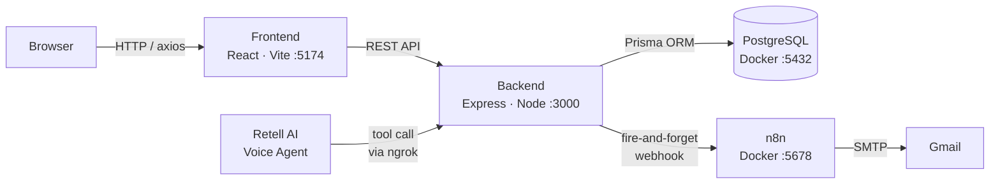

# Appointment System

A full-stack appointment booking system. Clients book via a web form or by phone through a voice agent; an admin dashboard manages all appointments with email notifications on every status change.

---

## Features

- Guest appointment booking via public web form
- Admin dashboard — confirm, cancel, or delete appointments
- Past-date prevention and double-booking protection
- JWT-based admin authentication (httpOnly cookie)
- Email notifications on booking and status changes (via n8n + Gmail SMTP)
- Voice booking via Retell AI voice agent
- Loading skeletons, toast notifications, and confirmation dialogs

## Tech Stack

| Layer | Technology |
|---|---|
| Frontend | React 19, TypeScript, Vite, Shadcn/ui, Tailwind CSS 4, React Router v6, React Hook Form + Zod |
| Backend | Node.js 24, Express 4, TypeScript, Prisma 5, PostgreSQL 16 |
| Validation | Zod (shared schemas on both sides) |
| Auth | JWT in httpOnly cookie, bcryptjs |
| Automation | n8n (self-hosted workflow engine → Gmail SMTP) |
| Voice agent | Retell AI + ngrok |
| Infrastructure | Docker Compose |
| Testing | Vitest (unit), Playwright (E2E) |

## Architecture



## Quick Start

### Prerequisites

- Node.js 24+
- Docker + Docker Compose
- ngrok (optional, required for Retell voice booking)
- A Retell AI account (optional, for voice booking)

### 1. Start infrastructure

```bash
docker compose up -d
```

This starts PostgreSQL on `:5432` and n8n on `:5678`.

### 2. Set up the backend

```bash
cd backend
cp .env.example .env
# Edit .env:
#   - Generate JWT_SECRET with: openssl rand -base64 32
#   - Set ADMIN_EMAIL and ADMIN_PASSWORD for your admin account
npm install
npx prisma migrate dev
npm run dev
```

The admin user is created automatically on first boot from `ADMIN_EMAIL`/`ADMIN_PASSWORD`.

### 3. Set up the frontend

```bash
cd frontend
cp .env.example .env   # defaults work out of the box
npm install
npm run dev
```

### 4. Open the app

| URL | Description |
|---|---|
| http://localhost:5174/book | Public booking page |
| http://localhost:5174/login | Admin login |
| http://localhost:5174/admin | Admin dashboard (requires login) |
| http://localhost:3000/health | Backend health check |

**Admin login:** use the `ADMIN_EMAIL` and `ADMIN_PASSWORD` values from your `.env` file. The admin account is created automatically on first boot.

### 5. n8n email notifications (optional)

1. Open http://localhost:5678
2. Create a workflow with:
   - **Webhook** trigger at `/webhook/appointment-created`
   - **Code** node to format the email body
   - **Send Email** node (Gmail SMTP, HTML format)
3. Click **Publish** to activate

Repeat for appointment status changes (`/webhook/appointment-status-changed`).

### 6. Retell voice agent (optional)

Create a **Single Prompt Agent** in Retell with this system prompt:

```
You are a friendly appointment booking assistant. Your job is to help callers book an appointment over the phone.
Collect the following information one at a time, in a natural conversational flow:
1. Full name
2. Phone number
3. Email address (spell it out if needed)
4. Service needed — options are: General Consultation, Follow-up, Initial Visit, Procedure, or Emergency
5. Preferred date (confirm month, day, and year)
6. Preferred time (confirm AM or PM)
Once you have all six pieces of information, confirm them back to the caller clearly. Then use the book_appointment tool to create the appointment.
After booking, tell the caller their appointment is booked and they will receive a confirmation email shortly.
Keep responses short and clear. If asked about pricing or medical questions, say you can only help with scheduling.
```

Then wire up the tool:

1. Run `ngrok http 3000` and copy the HTTPS URL
2. In Retell, create a custom tool named `book_appointment`:
   - **URL:** `<ngrok-url>/retell/tool`
   - **Payload type:** Args only
   - **Parameters:**

| Name | Description | Type | Required |
|---|---|---|---|
| `clientName` | Full name of the caller | String | Yes |
| `clientPhone` | Caller's Phone number | String | Yes |
| `clientEmail` | Caller's Email address | String | Yes |
| `date` | Appointment date in `YYYY-MM-DD` format | String | Yes |
| `time` | Appointment time in `HH:MM` (24-hour) format | String | Yes |
| `service` | One of: `General Consultation`, `Follow-up`, `Initial Visit`, `Procedure`, `Emergency` | String | Yes |

3. The ngrok URL changes on each restart (free plan) — update it in Retell each session

## Testing

```bash
# Backend unit tests (Zod schema validation)
cd backend && npm test

# Frontend E2E (requires full stack running)
cd frontend && npm run test:e2e
```

## API Reference

| Method | Path | Auth | Description |
|---|---|---|---|
| `GET` | `/appointments` | Admin | List all appointments |
| `GET` | `/appointments/:id` | Admin | Get single appointment |
| `POST` | `/appointments` | Public | Create (guest booking) |
| `PATCH` | `/appointments/:id/status` | Admin | Update status |
| `DELETE` | `/appointments/:id` | Admin | Delete |
| `POST` | `/auth/login` | — | Admin login |
| `POST` | `/auth/logout` | — | Admin logout |
| `GET` | `/auth/me` | Cookie | Current session |
| `POST` | `/retell/tool` | — | Voice agent tool call |
| `GET` | `/ping` | — | Health check (bypasses middleware) |
| `GET` | `/health` | — | DB connectivity check |

## Project Structure

```
appointment-system/
├── backend/
│   ├── src/
│   │   ├── controllers/    # HTTP handlers
│   │   ├── services/       # Business logic + Prisma queries
│   │   ├── routes/         # Express routers
│   │   ├── schemas/        # Zod validation schemas
│   │   ├── middleware/     # validate, requireAuth
│   │   └── lib/            # prisma singleton, auth helpers, n8n webhooks
│   └── prisma/             # schema.prisma + migrations
└── frontend/
    ├── src/
    │   ├── pages/          # BookingPage, AppointmentsPage, LoginPage
    │   ├── components/     # AppointmentForm, ProtectedRoute, Shadcn ui/
    │   ├── contexts/       # AuthContext
    │   ├── api/            # axios client + all API calls
    │   └── lib/            # utils, services list
    └── e2e/                # Playwright tests
```

## Learning Outcomes

This project was built as a hands-on learning project. See [LEARNING.md](LEARNING.md) for detailed notes on every concept covered — from layered architecture and Zod validation to JWT auth, n8n webhooks, and voice agents.

## License

MIT — see [LICENSE](LICENSE).
